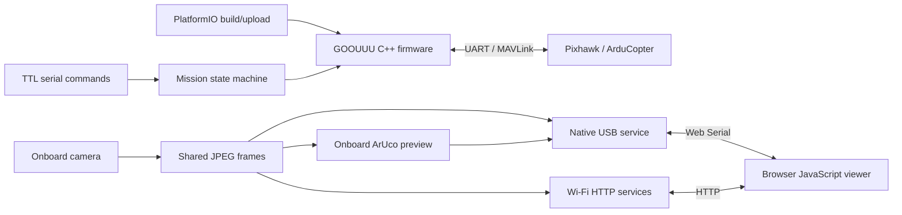

# Code architecture

The application runs as compiled Arduino C++ on one GOOUUU ESP32-S3-CAM N16R8. The root `platformio.ini` selects `Code/`; VS Code build/upload tasks use that configuration.

`Code/main.cpp` defines Arduino `setup()` and `loop()`. Startup initializes Pixhawk UART reception, camera capture, camera controls, ArUco analysis and USB services; camera initialization also starts Wi-Fi and the dashboard. The main loop polls MAVLink, advances explicitly started missions, reads serial commands, publishes telemetry and updates the status LED.

| Component | Responsibility |
| --- | --- |
| `Code/Camera/camera_service.cpp` | Sensor initialization, JPEG capture/cache, image HTTP handlers and optional photo storage |
| `Code/Camera/camera_controls.cpp` | Exposure/gain and altitude-profile application |
| `Code/Web Server/dashboard.cpp` | HTTP dashboard, telemetry and control endpoints |
| `Code/Camera/wired_camera.cpp` | Native USB framed video and camera-control requests |
| `Code/ArUco/aruco_service.cpp` | JPEG analysis, marker detection, pose and preview metadata |
| `Code/Pixhawk Communication/wire.h` | Custom MAVLink packet encoding, parsing and checksum validation |
| `Code/Pixhawk Communication/vehicle.h` | UART connection, telemetry state and MAVLink command helpers |
| `Code/Flight Missions/mission.h` | Flight mission state machine and external marker observations |

The MAVLink implementation supports the message subset used by the missions. It transmits MAVLink 1 and receives unsigned MAVLink 1/2; signed packets are rejected. It does not depend on DroneKit or a generated MAVLink runtime library.

`Code/Web Server/viewer.html` runs JavaScript in the laptop browser. `Helpers/Update Web Page.py` generates `Code/Web Server/dashboard_page.h`, which is compiled into the firmware for HTTP delivery. Keep both copies synchronized.

Camera capture and onboard ArUco analysis run in separate workers. Unchecking the viewer overlay does not stop onboard analysis. The ArUco preview is separate from flight: missions receive marker centers through explicit `marker ...` TTL serial messages, not from `aruco_service`.

Python helper scripts run on the laptop only. C++ host tests and browser simulations are under the project root in `Checks/` directory. `Saved Results/` holds ignored reports and test outputs; `Build Tools/` holds downloaded tools; it is not an application source directory.
