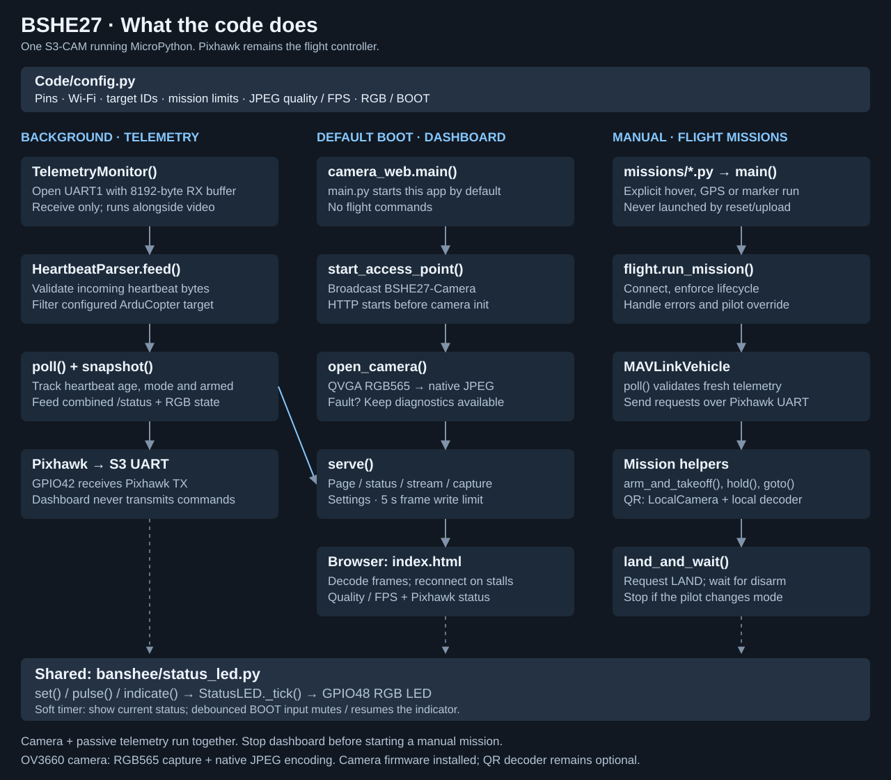

# Code map

The default boot app runs **Wi-Fi + live camera + passive Pixhawk telemetry together**.
`banshee/telemetry.py` polls UART1 in the same cooperative event loop as HTTP;
`/status` returns camera, Wi-Fi and Pixhawk states to the dashboard and LED.
It never writes to UART. `BOOT_APP = "telemetry"` remains a serial-only diagnostic.
The HTTP listener starts before camera initialization, so startup and camera
faults have a status page. The browser checks frames it actually decodes and
reconnects when progress stops; a new stream releases an older viewer.

Flight missions remain explicit programs using `banshee/flight.py` and
`banshee/mavlink/vehicle.py`. Stop the dashboard before running one: a mission
owns UART1 and QR missions own the camera. Reset to return to the dashboard.
QR decoding still needs an installed provider. Pixhawk remains the flight controller.

## Where to edit

| File under Code/ | Main functions | What it does |
| --- | --- | --- |
| `config.py` | `validate_runtime()`, `validate_board()` | Holds pins, Wi-Fi, target IDs, mission limits, RGB/BOOT controls, JPEG quality and FPS defaults; rejects incompatible hardware/pins. |
| `main.py` | `main()` | Validates runtime and starts the configured boot app: Integrated camera/Pixhawk dashboard by default, or serial-only telemetry. Never starts a mission. |
| `diagnostics/boot_telemetry.py` | `main()` | Preserved receive-only Pixhawk boot monitor, selected with `BOOT_APP = "telemetry"`. |
| `banshee/telemetry.py` | `TelemetryMonitor.poll()`, `snapshot()`, `close()` | Bounded receive-only UART polling; validates target heartbeat, reports age, mode and armed state; clears stale flight values. |
| `banshee/mavlink/heartbeat.py` | `HeartbeatParser.feed(data)` | Turns incoming serial bytes into CRC-checked heartbeat dictionaries. |
| `apps/camera_web.py` | `main()`, `start_access_point()`, `serve()` | Runs video and passive telemetry together; serves `/`, `/status`, `/stream`, `/capture` and runtime `/settings`. Bounds client work and whole-frame writes. |
| `web/index.html` | Browser `start()`, `stop()`, `refresh()`, `showTelemetry()` | Reads MJPEG, checks decoded frame progress, reconnects, applies quality/FPS settings and shows Pixhawk state. Edit the page design here. |
| `banshee/camera.py` | `open_camera()`, `EncodedCamera.capture()`, `set_quality()`, `LocalCamera.marker()` | Captures RGB565 and encodes JPEGs with adjustable quality; QR uses separate fixed QVGA grayscale capture and an optional decoder. |
| `banshee/status_led.py` | `set()`, `pulse()`, `set_enabled()`, `is_enabled()`, `indicate()` | Preserves status patterns; `StatusLED._tick()` also reads the debounced BOOT input to mute/resume the RGB LED. |
| `missions/hover.py`, `hover_gps.py` | `main()`, `mission(vehicle)` | Explicit takeoff, timed hover and landing examples. |
| `missions/move_gps.py`, `circle.py` | `main()`, `mission(vehicle)` | Explicit GPS movement/circle examples. |
| `missions/qr_landing.py` | `main()`, `land_on_qr()`, `yaw_error()` | Requires real QR detections before connecting; centers and aligns heading before allowing descent. Decoder not bundled. |
| `missions/aruco_*.py` | `main()`, `land_on_aruco()` | Marker missions requiring an onboard provider registered through `banshee/vision.py`; none is bundled. |
| `banshee/flight.py` | `run_mission()`, `arm_and_takeoff()`, `hold()`, `goto_and_wait()`, `land_and_wait()` | Shared mission lifecycle, bounded waits, pilot override handling and error cleanup. These functions can command flight. |
| `banshee/mavlink/vehicle.py` | `detect_pixhawk_uart()`, `MAVLinkVehicle.poll()`, `set_mode()`, `arm()`, `takeoff()`, `goto()`, `send_body_velocity()` | UART/MAVLink protocol layer: validates telemetry, tracks freshness, sends commands and checks acknowledgments. |
| `diagnostics/` | `telemetry.main()`, `qr_camera.main()`, `led.main()` | Explicit Pixhawk, QR and RGB checks. No arming commands. |

## Build Stuff

`tools/board.py` runs on your **computer**. `runtime_files()` selects files from
`Code/`, `upload_arguments()` creates the upload plan, and `command()`/`main()`
run mpremote. The folder name **Code** is removed when uploading: `Code/main.py`
becomes `/main.py` on the S3, and package imports stay the same. Uploads stage
temporary files and verify size/SHA-256 before installing `main.py` last and
resetting. An interrupted final installation can still require another upload.

`Firmware/` keeps the interpreter, camera driver, native JPEG module, SDK,
licenses, source locks and image files visible. `build.sh` and `prepare_build.py`
prepare a separate Linux build copy with octal PSRAM, 16 MB flash and local JPEG
components; they never flash a board. See [Firmware Guide](Firmware%20Guide.md).

`tests/` runs on the computer with simulated hardware. `archive/` preserves the
older WROOM/XIAO/C++ work. `local/` holds machine-local backups and caches and is
ignored by Git. None of these files are uploaded to the S3.

`banshee/portal.py` answers local DNS queries for hotspot discovery.
The HTTP server redirects common phone portal probes to the dashboard.
The first camera/status request triggers camera initialization after a short delay,
allowing the dashboard HTML to be sent before camera startup.

Browser `receiveFrames()` now requests complete JPEGs sequentially and yields
to status polling between frames. Rendering errors are reported separately
from failed status requests. The raw MJPEG endpoint remains supported.

`banshee/http_transport.py` paces outgoing Wi-Fi packets and handles temporary
socket backpressure without blocking telemetry. `Code/config.py` holds the
conservative radio and image defaults; higher quality/FPS remain selectable.
