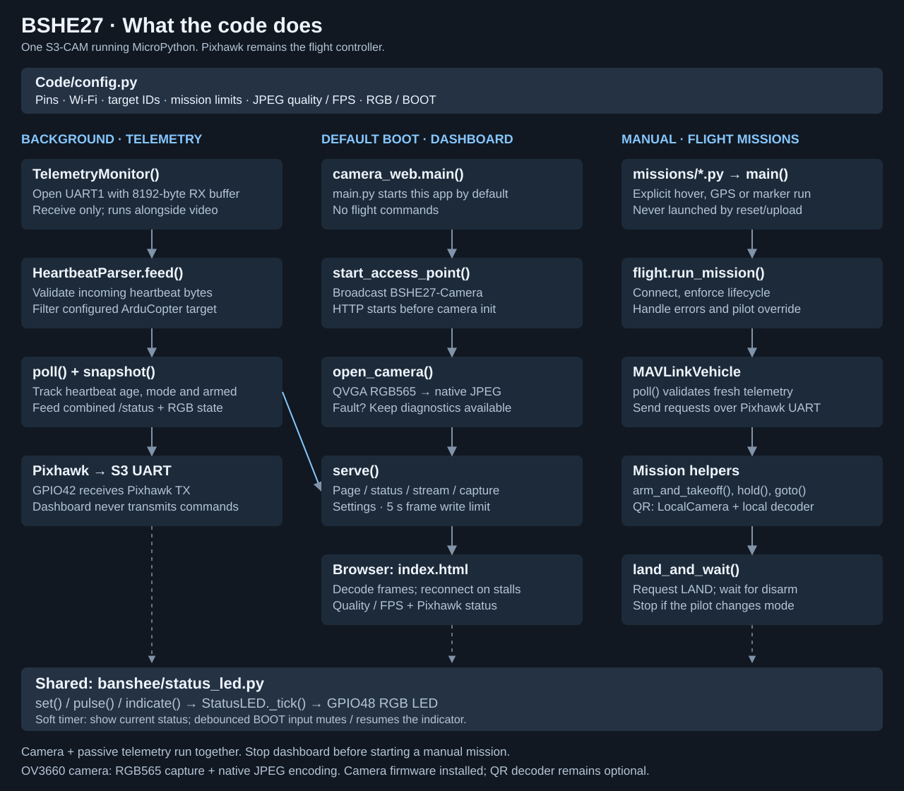

# BSHE27

One ESP32-S3-CAM running MicroPython, connected to a Pixhawk running ArduCopter.

```text
Code/          Your microcontroller code — edit here
Build Stuff/   Tools, tests, old experiments and backups — usually leave alone
Guides/        Setup instructions, LED meanings and the code diagram
```

**For AI assistants:** [Project rules](AGENTS.md) — folder layout, MicroPython, LEDs and working hardware conventions.

**Firmware source:** [What to edit and how to build](Guides/Firmware%20Guide.md) — source lives in **Build Stuff/Firmware/**.

**Start here:** [Setup](Guides/Setup.md) · [Code map and function guide](Guides/Code%20Map.md) · [RGB LED guide](Guides/LED%20Guide.md)

- **Ctrl+Shift+B** verifies and uploads **Code/**, then resets into the configured boot app (Wi-Fi by default).
- **BSHE27-Camera** Wi-Fi starts automatically after boot/reset. **S3: Camera preview** restarts that app manually.
- **S3: Monitor** opens serial output. Close a monitor before starting another task.
- **S3: RGB self-test** demonstrates all LED patterns without running a mission.
- Pins, Wi-Fi credentials and limits: **[Code/config.py](Code/config.py)**.

**Antenna:** keep the supplied external antenna connected; attaching it restored the phone camera connection on this board.

**Live camera:** camera-enabled MicroPython is installed and the OV3660 is
capturing color images. Connect to **BSHE27-Camera** using `WIFI_PASSWORD` in
**Code/config.py**, then open **http://192.168.4.1/**. Live view starts automatically;
The browser requests JPEG frames from `/capture`; `/stream` also provides MJPEG. One live viewer
at a time is supported. The combined dashboard starts again after reset. It also listens for Pixhawk
heartbeats on UART1 (GPIO42 RX, GPIO41 TX, 57600 baud), showing link health,
armed/disarmed state, numeric ArduCopter mode and heartbeat age alongside video.
No heartbeat yet is normal when Pixhawk is unplugged; video keeps working.
`TELEMETRY_ENABLED` in config can disable the monitor.

Use the webpage's **JPEG detail (35–90)** and **frame-rate limit (1–15 FPS)**
controls to trade image detail for smaller files and faster transfer. Resolution
stays **320 × 240**; actual FPS depends on the camera and Wi-Fi. Reset restores
`CAMERA_JPEG_QUALITY` and `CAMERA_FPS_LIMIT` from `Code/config.py`.

Press **BOOT briefly after startup** to mute the RGB indicator; press it again
to show the current status. This lasts until reset. Holding BOOT during reset
still enters the board's download mode.

This sensor's direct JPEG mode fails in the current native driver, so BSHE27
captures RGB565 and uses the firmware's JPEG encoder. QR landing still needs
a local decoder. No flight mission starts automatically.

See the [LED guide](Guides/LED%20Guide.md) for the full counted-blink table.

| Signal | Meaning |
| --- | --- |
|  once / twice | Hotspot broadcasting / device joined |
|  once / twice | Streaming / streaming with Pixhawk |
|  twice | Previously connected Pixhawk lost |
|  once / twice | Camera fault, no device / device joined |

Flight missions remain explicit; stop the dashboard before a mission takes UART/camera ownership. Reset returns to the dashboard.

See the LED guide for all blink counts, fault priorities and timing. Open Markdown Preview with **Ctrl+Shift+V**
to see the colored labels and diagram.



**Connection defaults:** external antenna attached, JPEG quality 35 and a 1 FPS
ceiling. Wi-Fi compatibility mode and paced writes reduce radio pressure.
Raise quality or frame rate from the webpage after checking stability.
