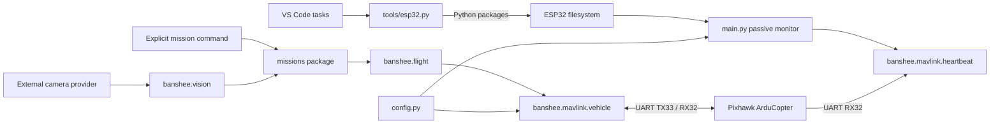

# Code architecture

## Board code

- `main.py` is the only automatic boot entry point. It remains a receive-only
  heartbeat monitor and gets UART settings from `config.py`.
- `banshee/mavlink/heartbeat.py` implements the passive parser. It consumes
  signature bytes without authentication and sends no messages.
- `banshee/mavlink/vehicle.py` implements the cooperative command client. It
  validates supported message CRCs, processes telemetry, sends heartbeats,
  confirms commands and rejects signed control telemetry.
- `banshee/flight.py` coordinates the mission lifecycle and bounded waits.
- `banshee/vision.py` validates camera-provider output; it does not detect
  markers. `banshee/compat.py` isolates timing differences for desktop tests.
- `missions/` contains flight entry points. `diagnostics/` contains inspection
  tools without flight control. Absolute package imports work from the board
  filesystem root.

## Host code

`tools/esp32.py` collects only Python source under `device/`, preserves package
paths on upload, and installs `main.py` last. New modules need no manual upload
file-list edit. It also wraps the existing monitor, device listing and
telemetry check. No flight mission is started by these host commands.

`tests/unit/` covers protocol and simulated mission behavior. Reusable fake
hardware lives in `tests/support/`. `tests/reference/` checks interoperability
with the optional generated pymavlink library.

`reference/desktop/` preserves the old desktop code. `docs/history/` preserves
the conversion source and prior audit. `local/` contains ignored machine-local
reports, scratch files, firmware downloads, cached bytecode and backups.
